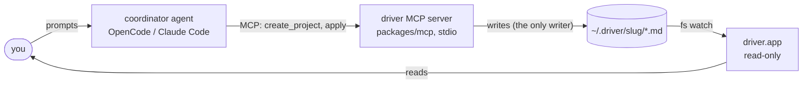

# driver

driver is a read-only desktop view of agent-run projects. A coordinator agent keeps each project as
a folder of plain markdown files under `~/.driver/`, through a local MCP server. The desktop app
watches those files and shows, per project, what needs you, what is blocked, and how far along it
is. You read; agents write. You never edit the files or the UI; you talk to the coordinator in your
terminal.



The full design (file format, write protocol, milestones) is [`docs/plan.md`](docs/plan.md).

## Quickstart

```sh
cd /Users/michaelhelvey/dev/helvetici/driver
bun install
bun --cwd apps/desktop tauri build
cp -R apps/desktop/src-tauri/target/release/bundle/macos/driver.app /Applications/
mkdir -p ~/.driver
claude mcp add --scope user driver -- bun /Users/michaelhelvey/dev/helvetici/driver/packages/mcp/src/main.ts
```

Then add the OpenCode entry from [Hook it up to agents](#hook-it-up-to-agents), paste
[the AGENTS.md snippet](#the-agentsmd-snippet) into a project, open driver, and ask the coordinator
to set up a driver project. Change `/Users/michaelhelvey/dev/helvetici/driver` everywhere if your
checkout lives somewhere else.

## Install

Prerequisites: macOS, [bun](https://bun.sh) 1.4+, and a Rust toolchain (`rustup`, stable) for Tauri.
Xcode command line tools must be installed (`xcode-select --install`).

```sh
bun install
bun --cwd apps/desktop tauri build
```

The first build takes a couple of minutes (Rust) and writes
`apps/desktop/src-tauri/target/release/bundle/macos/driver.app` (about 12 MiB, ad-hoc signed). Copy
it to `/Applications`:

```sh
cp -R apps/desktop/src-tauri/target/release/bundle/macos/driver.app /Applications/
```

Rebuild and copy again after you pull.

### `DRIVER_ROOT`

Both the MCP server and the app read projects from `DRIVER_ROOT`, default `~/.driver`.

- It must be an **absolute** path; `~` is not expanded. A relative path makes the MCP server exit
  and the app show an error.
- The MCP server creates the folder if it is missing. The app does not: if `~/.driver` did not exist
  when the app started, it shows nothing and watches nothing until you restart it. Run
  `mkdir -p ~/.driver` before the first launch.
- To point both at another folder, set `DRIVER_ROOT` in the MCP server's `env` / `environment`
  entry, and launch the app with `open -a driver --env DRIVER_ROOT=/abs/path`. An app opened from
  Finder or Spotlight does not see your shell's env, so it always uses `~/.driver`.

## Hook it up to agents

Register the MCP server once, globally. Every harness spawns it with `bun` and the absolute path to
this checkout's `packages/mcp/src/main.ts`. It needs no env when you use `~/.driver`.

### OpenCode

Add a `driver` entry under `mcp.servers` in `~/.config/opencode/opencode.json` (OpenCode V2 puts
servers under `mcp.servers`, not directly under `mcp`):

```json
{
  "$schema": "https://opencode.ai/config.json",
  "mcp": {
    "servers": {
      "driver": {
        "type": "local",
        "command": ["bun", "/Users/michaelhelvey/dev/helvetici/driver/packages/mcp/src/main.ts"]
      }
    }
  }
}
```

or let the CLI write it:

```sh
opencode mcp add driver --global -- bun /Users/michaelhelvey/dev/helvetici/driver/packages/mcp/src/main.ts
```

To use another root, add `"environment": { "DRIVER_ROOT": "/abs/path" }` to the entry. Check it with
`opencode mcp list`. With OpenCode's default Code Mode, agents call the tools as
`tools.driver.apply(...)`.

### Claude Code

```sh
claude mcp add --scope user driver -- bun /Users/michaelhelvey/dev/helvetici/driver/packages/mcp/src/main.ts
```

Add `-e DRIVER_ROOT=/abs/path` after `driver` for another root. Check it with `claude mcp list`.

The same server as a checked-in `.mcp.json` (project scope, for sharing with a repo):

```json
{
  "mcpServers": {
    "driver": {
      "type": "stdio",
      "command": "bun",
      "args": ["/Users/michaelhelvey/dev/helvetici/driver/packages/mcp/src/main.ts"],
      "env": {}
    }
  }
}
```

### The tools

| tool             | what the agent sees (abridged)                                                                                           |
| ---------------- | ------------------------------------------------------------------------------------------------------------------------ |
| `list_projects`  | every project's slug, title, percent, needs-you and blocked counts, last update                                          |
| `get_project`    | one project's state: summary, phases, tasks with labels and statuses, 10 newest log entries. "Call this before `apply`." |
| `read`           | raw markdown of tasks, phases, `"project"` or `"log"`, frontmatter included                                              |
| `needs_me`       | every `needs-you` and `blocked` task across projects                                                                     |
| `create_project` | a new project with `project.md` and an empty `log.md`                                                                    |
| `apply`          | "The only way to change a project." One all-or-nothing batch of ops plus a log line                                      |

The full descriptions live in the zod schemas' `.describe()` text in
[`packages/core/src/tools.ts`](packages/core/src/tools.ts) and
[`packages/core/src/schemas.ts`](packages/core/src/schemas.ts). That text is what agents read, so it
is the source of truth for every rule below.

## Using it in a project

The tool descriptions already carry the file contract, so a project only needs to tell its
coordinator _that_ it should keep a driver project, and which habits to keep.

### The AGENTS.md snippet

Paste this into the project's `AGENTS.md` (OpenCode) or `CLAUDE.md` (Claude Code):

```md
## driver

Track this work as a driver project through the `driver` MCP server. The user watches it in the
driver app and never edits the files; you are the only writer.

- Once, at the start: `create_project` with `slug`, `title`, `repo` (this repo's path), and a
  `summary` of what the project is and where it stands. Then add phases and tasks with `apply`.
- Call `get_project` before every `apply`, so your changes are based on the current state.
- One `apply` per meaningful event (a PR opened or merged, a deploy, a verification, a question for
  the user), with every change in that one call. `log` is one or two sentences saying what happened
  and the evidence for it ("t4-coa merged as #52; beta deploy 4415 is green"). Describe what
  happened, not what you plan to do.
- Statuses: `{ kind: "todo" }`, `{ kind: "doing" }`, `{ kind: "done" }`,
  `{ kind: "needs-you", ask }` (one line saying exactly what you need from the user),
  `{ kind: "blocked", on, by? }` (`on` is what it waits for, `by` the id of a blocking task),
  `{ kind: "skipped", why }`.
- There is no `broken` status. If your own work fails (a build breaks, a deploy fails, you are
  stuck), set `needs-you` with the error as the `ask`. Do not leave it `doing`: that hides the
  failure from the user.
- There is no delete: mark work that's no longer needed as `skipped` and give a reason.
- Put notes, verification steps, and a checklist in each task's `body`; `- [ ]` / `- [x]` lines are
  counted as the task's steps. `body` replaces the whole body, so `read` the task first and send it
  back whole.
- Ids are lowercase slugs (`t4-coa`, `framework-apps`); `project` and `log` are reserved. Never type
  position labels like `03a.1`: `apply` numbers files for you.
```

### The first prompt

With the snippet in place, open the coordinator in the repo and say something like:

> set up a driver project for the sentry rollout: slug `pdk-2-sentry`. phases: `pdk-2.0` (bump the
> pdk and verify on beta), `canaries` (two canary lambdas, verified in Sentry), `rollout` (one task
> per remaining lambda). give each task a checklist of verification steps. then start on the first
> task.

The coordinator should answer with one `create_project` and one `apply` that creates the phases and
tasks. A typical `apply` after that:

```json
{
  "slug": "pdk-2-sentry",
  "log": "t4-coa merged as #52; beta deploy 4415 is green.",
  "ops": [
    { "op": "task", "id": "t4-coa", "pr": "#52", "status": { "kind": "done" } },
    {
      "op": "task",
      "id": "t4-authorization-platform",
      "status": { "kind": "needs-you", "ask": "cold start +290ms: keep the 500ms reserve?" }
    }
  ]
}
```

Ask it what's waiting on you from any project with "what does driver say needs me" (`needs_me`).

## The desktop app

The sidebar lists every project under the root (`1`–`9` are their numbers), with its percent and its
needs-you and blocked counts. A project whose files do not parse shows `error` there, and its page
shows the parse error, which names the file.

A project page, top to bottom:

- **Header**: the path to `project.md`, the title, the summary (the text of `project.md` before its
  first `##`), and when anything in the project last changed.
- **Headline**: percent done, `done / (all − skipped)`, as `9 of 27 tasks done · 1 skipped`, and
  "now in": the first phase with a task that is not `done` or `skipped`.
- **needs you**: tasks with `status: needs-you`, each with its `ask` line. This is your to-do list.
- **blocked**: tasks with `status: blocked`, with what they wait on (`blocked_on`) and the blocking
  task (`blocked_by`).
- **recent**: the newest entries of `log.md`.
- **Phases**: each phase with its note (the first line of `phase.md`), a bar of its task statuses,
  and its tasks with step counts (`2/5`, from the `- [ ]` / `- [x]` lines), repo, and PR.

Statuses: `◆` needs-you, `✕` blocked, `◐` doing, `○` todo, `●` done, `–` skipped.

Labels like `03a.1` are positions: phase `03a`, first task. They come from the `NN-` file and folder
prefixes, change when tasks move, and are display only. Agents refer to tasks by id.

`↵` opens the row under the cursor in the reader on the right: the file rendered as markdown, with
its frontmatter as a table. `r` shows the raw file, exactly as on disk.

### Keys

Press `?` in the app for this sheet. It is the `KEYS` table in
[`apps/desktop/src/keys.ts`](apps/desktop/src/keys.ts), which also binds the keys, so the two cannot
drift; `apps/desktop/test/readme.test.ts` fails when this table drifts from it.

| group    | keys      | does                             |
| -------- | --------- | -------------------------------- |
| move     | `j` `k`   | down / up                        |
|          | `g g` `G` | top / bottom                     |
|          | `^d` `^u` | half page                        |
|          | `a`       | first thing that needs you       |
|          | `g n`     | next that needs you, any project |
|          | `space`   | fold / unfold phase              |
|          | `b`       | jump to blocker                  |
| projects | `J` `K`   | next / prev project              |
|          | `1` … `9` | project by number                |
|          | `⌘K`      | palette — everything             |
|          | `p`       | open project.md                  |
|          | `L`       | open log.md                      |
| read     | `↵`       | toggle reader                    |
|          | `tab` `l` | focus reader                     |
|          | `h` `esc` | back to list                     |
|          | `r`       | raw file / rendered              |
|          | `y`       | copy file path                   |
|          | `c`       | copy a reference for an agent    |
| view     | `/`       | filter tasks                     |
|          | `[`       | toggle sidebar                   |
|          | `t`       | paper / cocoa theme              |
|          | `?`       | this                             |

`↓` `↑` work as `j` `k`, and `g p` as `p`. While the reader has focus, `j` `k` `^d` `^u` `g g` `G`
scroll it, and `h`, `esc` and `tab` go back to the list. In the list, `esc` closes the reader, else
clears the filter, and `Home` `End` go to the first / last row.

`c` copies a line to paste into your coordinator, so you can talk about the row under the cursor
without typing its path:

```
re t4-coa (t4-coa): /Users/you/.driver/pdk-2-sentry/03a-framework-apps/01-t4-coa.md
```

A task names its id and title, a phase header its id and title, the project header the project's
slug and title, and the recent-log row `log`. The path is the one `y` copies.

## File format

Everything is plain markdown with YAML frontmatter. You can `cat`, `grep`, and `git diff` all of it.

```
~/.driver/
  <project-slug>/
    project.md            # title, repo, started, updated; summary; then ## sections
    log.md                # append-only, oldest first: "## <ISO timestamp>" + text
    <NN>-<phase-slug>/    # 00-pdk-2.0, 03a-framework-apps
      phase.md            # title; first line of the body is the phase note
      <NN>-<task-slug>.md # title, status (+ ask / blocked_on / blocked_by / why), repo?, pr?, updated
```

Ids are the names without the `NN-` prefix. `apply` owns the prefixes, renames files when items
move, sets `updated`, and writes all-or-nothing under a `<project>/.lock`. Files and folders that
start with a dot (`.lock`, `.tmp-*`) are ignored by readers.

**Do not hand-edit project files while agents are running.** Ask the coordinator to make the change
through `apply`. A hand edit races `apply` and can leave a project that does not parse. The full
spec is in [`docs/plan.md`](docs/plan.md#file-layout). Real examples are in
[`packages/core/fixtures/`](packages/core/fixtures).

## Development

| what                                        | command                                                                    |
| ------------------------------------------- | -------------------------------------------------------------------------- |
| lint, format, types, all tests, browser e2e | `bun run validate`                                                         |
| unit tests only                             | `bun run test`                                                             |
| browser e2e: every key, no mouse            | `bun run e2e:web`                                                          |
| format                                      | `bun run format`                                                           |
| browser build on the fixtures               | `bun --cwd apps/desktop dev`, then open `http://localhost:1420/`           |
| the app on `~/.driver`                      | `bun --cwd apps/desktop tauri dev`                                         |
| the app on the fixtures                     | `DRIVER_ROOT=$PWD/packages/core/fixtures bun --cwd apps/desktop tauri dev` |
| real-window e2e (builds Rust)               | `bun run e2e:desktop`                                                      |
| run the MCP server by hand                  | `bun packages/mcp/src/main.ts`                                             |

- `packages/core`: schemas, `parseProject`, `planApply`, and the tool descriptions. Pure TS; the
  only module that knows the file format.
- `packages/mcp`: the stdio MCP server, the only writer. See
  [`packages/mcp/README.md`](packages/mcp/README.md).
- `apps/desktop`: the Tauri v2 + Solid 2 app. See [`apps/desktop/README.md`](apps/desktop/README.md)
  for its layout and scripts.
- `packages/core/fixtures/`: four sample projects (`pdk-2-sentry`, `driver`, `billing-ledger-v2`,
  `onboarding-docs`) in `apply`'s canonical form. Tests, the browser build, and the e2e run use
  them. To try the real app on them without touching `~/.driver`, use the `DRIVER_ROOT` line above.

`bun run validate` must be green before work is done. It ends with `bun run e2e:web`, which drives
the browser build in the installed Google Chrome (Playwright's `channel: "chrome"`), so Chrome must
be installed. `bun run e2e:desktop` is not part of it, because it builds the Rust side; it also
writes to the real system clipboard (the `y` and `c` checks), so expect your clipboard to change.
Every verification lever, and the steps to accept a change by hand, are in
[`.agents/skills/verify-driver/SKILL.md`](.agents/skills/verify-driver/SKILL.md).

## Troubleshooting

- **`apply` fails with `<root>/<project>/.lock is still there after 10000ms`.** A crashed `apply`
  left its lock behind. The message names the path. Delete that file, but only if no `apply` is
  running. `DRIVER_LOCK_TIMEOUT_MS` changes the wait.
- **`DRIVER_ROOT must be an absolute path`.** You set `DRIVER_ROOT` to a relative path or one
  starting with `~`, which is not expanded in JSON configs. Use the full path.
- **The app shows "This project's files do not parse."** The error under it names the file and the
  field. Usually a hand edit. Ask the coordinator to fix it with `apply`, or fix the file by hand
  while no agent is running.
- **The app is empty but the folder has projects.** The folder did not exist when the app started:
  restart the app. Or the app and the MCP server use different roots: the app shows its root in the
  sidebar footer and the status line.
- **The agent doesn't see the tools.** Run `opencode mcp list` or `claude mcp list`. Start the
  server by hand to see startup errors:
  `bun /Users/michaelhelvey/dev/helvetici/driver/packages/mcp/src/main.ts` prints
  `{"started":"/Users/you/.driver"}` to stderr and then waits on stdin.
- **What did the server do?** It logs each tool call to stderr as one JSON line:
  `{"tool":"apply","project":"pdk-2-sentry","ops":1,"ms":12,"error":null}`. stdout carries only MCP
  messages. Your harness keeps the server's stderr in its MCP logs.
