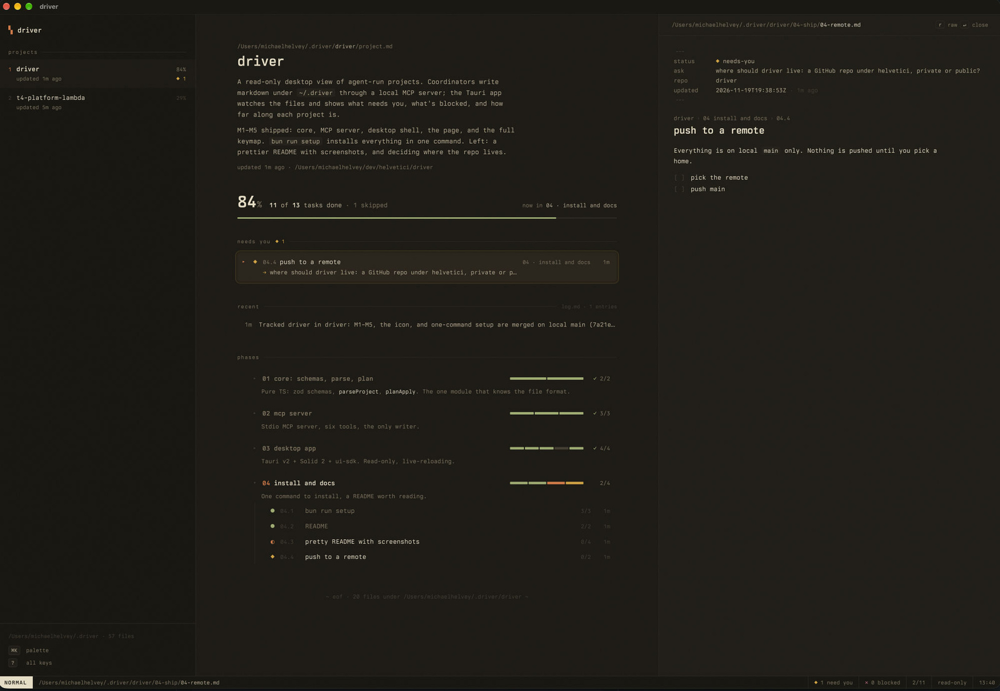
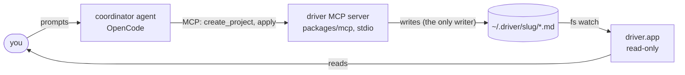
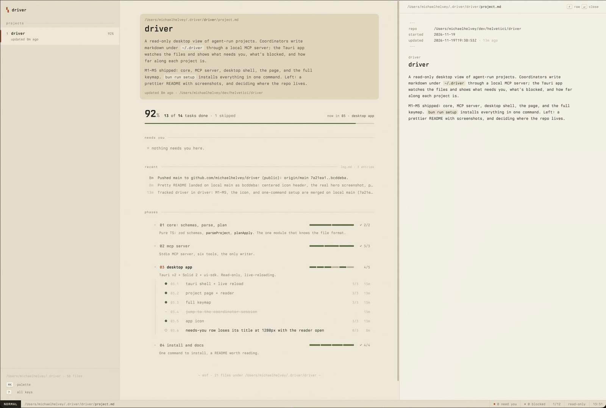

<p align="center">
  
</p>

<h1 align="center">driver</h1>

<p align="center">
  <strong>A read-only desktop view of the projects your agents run.</strong>
  <br>
  Agents write plain markdown. You see what needs you.
</p>

<p align="center">
  
  
  
  
</p>

<p align="center">
  
</p>

<p align="center">
  <sub>driver tracking its own build. The headline says how far along it is, <b>needs you</b> is
  your to-do list, and the reader on the right opens the task file behind the row under the
  cursor.</sub>
</p>

<p align="center">
  <a href="#quickstart">Quickstart</a> ·
  <a href="#the-desktop-app">The app</a> ·
  <a href="#keys">Keys</a> ·
  <a href="#the-tools">Tools</a> ·
  <a href="#file-format">File format</a> ·
  <a href="#development">Development</a>
</p>

A coordinator agent keeps each project as a folder of plain markdown files under `~/.driver/`,
through a local MCP server. The desktop app watches those files and shows, per project, what needs
you, what is blocked, and how far along it is. You read; agents write. You never edit the files or
the UI; you talk to the coordinator in your terminal.

## How it works



The full design (file format, write protocol, milestones) is [`docs/plan.md`](docs/plan.md).

## Quickstart

Needs macOS, [bun](https://bun.sh) 1.4+, a Rust toolchain (`rustup`), the Xcode command line tools,
and [OpenCode](https://opencode.ai).

```sh
git clone <this repo> driver && cd driver && bun run setup
```

Then open driver, and in any project tell your coordinator:

> track this in driver

That's it. `bun run setup` builds `driver.app` into `/Applications` (quitting and restarting it if
it is running), creates `~/.driver`, and registers the MCP server in OpenCode's global config,
pointing at this checkout. Rerun it after you pull, or after you move the checkout: it upgrades the
app and fixes the registered path, and changes nothing that is already right.
`bun run setup --no-app` only registers the MCP server. The first build takes a couple of minutes
(Rust).

The MCP server sends its habits (how to start a project, `get_project` before every `apply`, one
`apply` per event, `needs-you` when stuck) as its `instructions`, which OpenCode puts in the
coordinator's system prompt, so a project needs no `AGENTS.md` snippet. The text is
`DRIVER_INSTRUCTIONS` in [`packages/core/src/tools.ts`](packages/core/src/tools.ts).

<details>
<summary><strong>Manual setup</strong></summary>

<br>

What `bun run setup` does, by hand, from the checkout:

```sh
bun install
bun --cwd apps/desktop tauri build
cp -R apps/desktop/src-tauri/target/release/bundle/macos/driver.app /Applications/
mkdir -p ~/.driver
opencode mcp add driver --global -- "$(which bun)" "$PWD/packages/mcp/src/main.ts"
```

That writes this entry under `mcp.servers` in `~/.config/opencode/opencode.json(c)`:

```json
{ "driver": { "type": "local", "command": ["/abs/bun", "/abs/driver/packages/mcp/src/main.ts"] } }
```

Check it with `opencode mcp list`. With OpenCode's default Code Mode, agents call the tools as
`tools.driver.apply(...)`.

</details>

<details>
<summary><strong>Another root: <code>DRIVER_ROOT</code></strong></summary>

<br>

Both the MCP server and the app read projects from `DRIVER_ROOT`, default `~/.driver`.

- It must be an **absolute** path; `~` is not expanded. A relative path makes the MCP server exit
  and the app show an error.
- The MCP server creates the folder if it is missing. The app does not: if `~/.driver` did not exist
  when the app started, it shows nothing and watches nothing until you restart it. Run
  `mkdir -p ~/.driver` before the first launch.
- To point both at another folder, add `"environment": { "DRIVER_ROOT": "/abs/path" }` to the
  `driver` entry in OpenCode's config (`bun run setup` keeps it when it re-registers), and launch
  the app with `open -a driver --env DRIVER_ROOT=/abs/path`. An app opened from Finder or Spotlight
  does not see your shell's env, so it always uses `~/.driver`.

</details>

## Using it in a project

"track this in driver" is enough: the coordinator makes a project named after the repo directory and
fills in phases and tasks from the conversation. Say more when you want a particular shape:

> track this in driver as `pinion-2-plugins`. phases: `pinion-2.0` (release 2.0 and verify it on the
> example site), `canaries` (two canary plugins, verified on the example site), `rollout` (one task
> per remaining plugin). give each task a checklist of verification steps. then start on the first
> task.

The coordinator should answer with one `create_project` and one `apply` that creates the phases and
tasks. A typical `apply` after that:

```json
{
  "slug": "pinion-2-plugins",
  "log": "plugin-sitemap merged as #64; release 3.0.0 is published.",
  "ops": [
    { "op": "task", "id": "plugin-sitemap", "pr": "#64", "status": { "kind": "done" } },
    {
      "op": "task",
      "id": "plugin-images",
      "status": { "kind": "needs-you", "ask": "cold build +290ms: keep the 500ms reserve?" }
    }
  ]
}
```

Ask it what's waiting on you from any project with "what does driver say needs me" (`needs_me`).

## The desktop app

The sidebar lists every project under the root (`1`–`9` are their numbers), with its percent and its
needs-you and blocked counts. A project whose files do not parse shows `error` there, and its page
shows the parse error, which names the file.

A project page, top to bottom:

- **Header**: the path to `project.md`, the title, the summary (the text of `project.md` before its
  first `##`), and when anything in the project last changed.
- **Headline**: percent done, `done / (all − skipped)`, as `9 of 27 tasks done · 1 skipped`, and
  "now in": the first phase with a task that is not `done` or `skipped`.
- **needs you**: tasks with `status: needs-you`, each with its `ask` line. This is your to-do list.
- **blocked**: tasks with `status: blocked`, with what they wait on (`blocked_on`) and the blocking
  task (`blocked_by`).
- **recent**: the newest entries of `log.md`.
- **Phases**: each phase with its note (the first line of `phase.md`), a bar of its task statuses,
  and its tasks with step counts (`2/5`, from the `- [ ]` / `- [x]` lines), repo, and PR.

Statuses: `◆` needs-you, `✕` blocked, `◐` doing, `○` todo, `●` done, `–` skipped.

Labels like `03a.1` are positions: phase `03a`, first task. They come from the `NN-` file and folder
prefixes, change when tasks move, and are display only. Agents refer to tasks by id.

`↵` opens the row under the cursor in the reader on the right: the file rendered as markdown, with
its frontmatter as a table. `r` shows the raw file, exactly as on disk.

### Two themes

`t` switches between cocoa (above) and paper, and the app remembers the choice.

<p align="center">
  
</p>

### Keys

Press `?` in the app for this sheet. It is the `KEYS` table in
[`apps/desktop/src/keys.ts`](apps/desktop/src/keys.ts), which also binds the keys, so the two cannot
drift; `apps/desktop/test/readme.test.ts` fails when this table drifts from it.

| group    | keys      | does                             |
| -------- | --------- | -------------------------------- |
| move     | `j` `k`   | down / up                        |
|          | `g g` `G` | top / bottom                     |
|          | `^d` `^u` | half page                        |
|          | `a`       | first thing that needs you       |
|          | `g n`     | next that needs you, any project |
|          | `space`   | fold / unfold phase              |
|          | `b`       | jump to blocker                  |
| projects | `J` `K`   | next / prev project              |
|          | `1` … `9` | project by number                |
|          | `⌘K`      | palette — everything             |
|          | `p`       | open project.md                  |
|          | `L`       | open log.md                      |
| read     | `↵`       | toggle reader                    |
|          | `tab` `l` | focus reader                     |
|          | `h` `esc` | back to list                     |
|          | `r`       | raw file / rendered              |
|          | `y`       | copy file path                   |
|          | `c`       | copy a reference for an agent    |
| view     | `/`       | filter tasks                     |
|          | `[`       | toggle sidebar                   |
|          | `t`       | paper / cocoa theme              |
|          | `?`       | this                             |

`↓` `↑` work as `j` `k`, and `g p` as `p`. While the reader has focus, `j` `k` `^d` `^u` `g g` `G`
scroll it, and `h`, `esc` and `tab` go back to the list. In the list, `esc` closes the reader, else
clears the filter, and `Home` `End` go to the first / last row.

`c` copies a line to paste into your coordinator, so you can talk about the row under the cursor
without typing its path:

```
re plugin-sitemap (plugin-sitemap): /Users/you/.driver/pinion-2-plugins/03a-framework-apps/01-plugin-sitemap.md
```

A task names its id and title, a phase header its id and title, the project header the project's
slug and title, and the recent-log row `log`. The path is the one `y` copies.

## The tools

| tool             | what the agent sees (abridged)                                                                                           |
| ---------------- | ------------------------------------------------------------------------------------------------------------------------ |
| `list_projects`  | every project's slug, title, percent, needs-you and blocked counts, last update                                          |
| `get_project`    | one project's state: summary, phases, tasks with labels and statuses, 10 newest log entries. "Call this before `apply`." |
| `read`           | raw markdown of tasks, phases, `"project"` or `"log"`, frontmatter included                                              |
| `needs_me`       | every `needs-you` and `blocked` task across projects                                                                     |
| `create_project` | a new project with `project.md` and an empty `log.md`                                                                    |
| `apply`          | "The only way to change a project." One all-or-nothing batch of ops plus a log line                                      |

The full descriptions live in the zod schemas' `.describe()` text in
[`packages/core/src/tools.ts`](packages/core/src/tools.ts) and
[`packages/core/src/schemas.ts`](packages/core/src/schemas.ts), and the habits in
`DRIVER_INSTRUCTIONS` in [`packages/core/src/tools.ts`](packages/core/src/tools.ts). That text is
what agents read, so it is the source of truth for every rule below.

## File format

Everything is plain markdown with YAML frontmatter. You can `cat`, `grep`, and `git diff` all of it.

```
~/.driver/
  <project-slug>/
    project.md            # title, repo, started, updated; summary; then ## sections
    log.md                # append-only, oldest first: "## <ISO timestamp>" + text
    <NN>-<phase-slug>/    # 00-pinion-2.0, 03a-framework-apps
      phase.md            # title; first line of the body is the phase note
      <NN>-<task-slug>.md # title, status (+ ask / blocked_on / blocked_by / why), repo?, pr?, updated
```

Ids are the names without the `NN-` prefix. `apply` owns the prefixes, renames files when items
move, sets `updated`, and writes all-or-nothing under a `<project>/.lock`. Files and folders that
start with a dot (`.lock`, `.tmp-*`) are ignored by readers.

> [!WARNING]
> **Do not hand-edit project files while agents are running.** Ask the coordinator to make the
> change through `apply`. A hand edit races `apply` and can leave a project that does not parse.

The full spec is in [`docs/plan.md`](docs/plan.md#file-layout). Real examples are in
[`packages/core/fixtures/`](packages/core/fixtures).

## Troubleshooting

<details>
<summary><strong>Common failures and what to do</strong></summary>

<br>

- **`apply` fails with `<root>/<project>/.lock is still there after 10000ms`.** A crashed `apply`
  left its lock behind. The message names the path. Delete that file, but only if no `apply` is
  running. `DRIVER_LOCK_TIMEOUT_MS` changes the wait.
- **`DRIVER_ROOT must be an absolute path`.** You set `DRIVER_ROOT` to a relative path or one
  starting with `~`, which is not expanded in JSON configs. Use the full path.
- **The app shows "This project's files do not parse."** The error under it names the file and the
  field. Usually a hand edit. Ask the coordinator to fix it with `apply`, or fix the file by hand
  while no agent is running.
- **The app is empty but the folder has projects.** The folder did not exist when the app started:
  restart the app. Or the app and the MCP server use different roots: the app shows its root in the
  sidebar footer and the status line.
- **The agent doesn't see the tools.** Rerun `bun run setup --no-app`, then `opencode mcp list`.
  Start the server by hand to see startup errors: `bun packages/mcp/src/main.ts` prints
  `{"started":"/Users/you/.driver"}` to stderr and then waits on stdin.
- **`bun run setup` fails.** The `✗` line says what failed and the `fix:` line under it what to run.
  Fix it and rerun; every step is safe to repeat.
- **What did the server do?** It logs each tool call to stderr as one JSON line:
  `{"tool":"apply","project":"pinion-2-plugins","ops":1,"ms":12,"error":null}`. stdout carries only
  MCP messages. Your harness keeps the server's stderr in its MCP logs.

</details>

## Development

<details>
<summary><strong>Commands, layout, and what <code>bun run validate</code> checks</strong></summary>

<br>

| what                                        | command                                                                    |
| ------------------------------------------- | -------------------------------------------------------------------------- |
| lint, format, types, all tests, browser e2e | `bun run validate`                                                         |
| unit tests only                             | `bun run test`                                                             |
| browser e2e: every key, no mouse            | `bun run e2e:web`                                                          |
| format                                      | `bun run format`                                                           |
| browser build on the fixtures               | `bun --cwd apps/desktop dev`, then open `http://localhost:1420/`           |
| the app on `~/.driver`                      | `bun --cwd apps/desktop tauri dev`                                         |
| the app on the fixtures                     | `DRIVER_ROOT=$PWD/packages/core/fixtures bun --cwd apps/desktop tauri dev` |
| real-window e2e (builds Rust)               | `bun run e2e:desktop`                                                      |
| run the MCP server by hand                  | `bun packages/mcp/src/main.ts`                                             |
| `bun run setup` on a temp HOME (builds)     | `bun scripts/setup-e2e.ts` (`--no-app` skips the build)                    |

- `packages/core`: schemas, `parseProject`, `planApply`, and the tool descriptions. Pure TS; the
  only module that knows the file format.
- `packages/mcp`: the stdio MCP server, the only writer. See
  [`packages/mcp/README.md`](packages/mcp/README.md).
- `apps/desktop`: the Tauri v2 + Solid 2 app. See [`apps/desktop/README.md`](apps/desktop/README.md)
  for its layout and scripts.
- `packages/core/fixtures/`: four sample projects (`pinion-2-plugins`, `driver`,
  `billing-ledger-v2`, `onboarding-docs`) in `apply`'s canonical form. Tests, the browser build, and
  the e2e run use them. To try the real app on them without touching `~/.driver`, use the fixtures
  line in the table above.

`bun run validate` must be green before work is done. It ends with `bun run e2e:web`, which drives
the browser build in the installed Google Chrome (Playwright's `channel: "chrome"`), so Chrome must
be installed. `bun run e2e:desktop` is not part of it, because it builds the Rust side; it also
writes to the real system clipboard (the `y` and `c` checks), so expect your clipboard to change.
Every verification lever, and the steps to accept a change by hand, are in
[`.agents/skills/verify-driver/SKILL.md`](.agents/skills/verify-driver/SKILL.md).

The README's images live in `docs/assets/`. Both are window captures of the installed app.
`hero.jpg` is resized with
`magick <capture> -strip -resize 1600x -quality 95 -sampling-factor 4:4:4 hero.jpg`, and `paper.png`
with `magick <capture> -strip -resize 1600x -dither None -colors 256 PNG8:paper.png`.
`bun apps/desktop/scripts/readme-preview.ts` renders the README offline, checks its links, and
screenshots it in light and dark.

</details>
